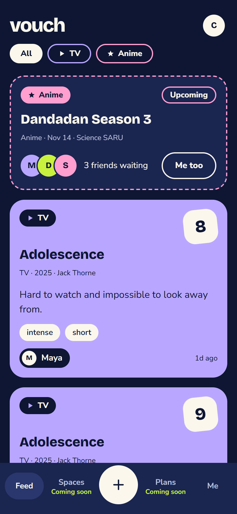
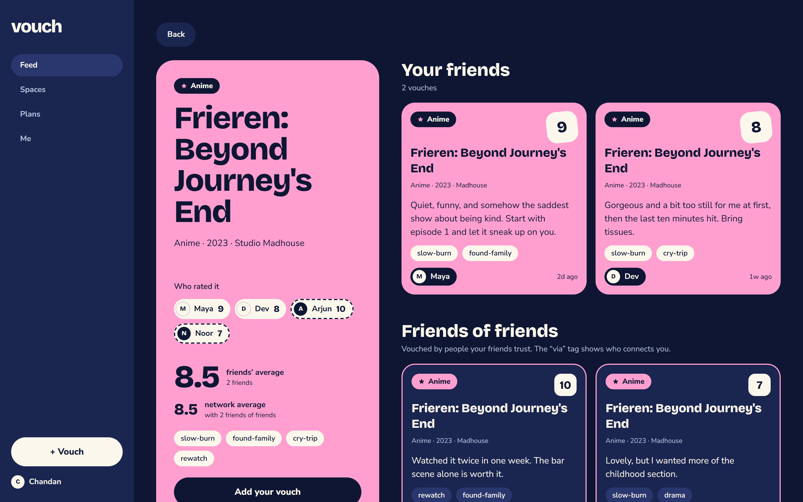

# Vouch

Invite-only TV and anime recommendations from people you actually know: rate it out of 10, say why, and your friends (and, clearly labelled, their friends) see it.

**Live:** https://vouch-ecru.vercel.app (runs on a mock API; any email signs in)

| Feed (mobile) | Show page (desktop) |
| --- | --- |
|  |  |

Every vouch shows its path: a friend's card is solid, a friend-of-a-friend's card is dashed and says who connects you ("via Dev"). You never borrow taste from a stranger.

## MVP scope

- **Shows only**: TV and anime (TMDB). Film, Book and Food, Spaces and Plans are "Coming soon".
- Magic-link sign-in, invites, friends and requests, vouches (rating, 280-character review, up to 3 tags), a two-hop feed, profiles, "Me too" anticipations.

## Tech stack

**Frontend (done):** Next.js 14 (App Router), TypeScript (strict), Tailwind CSS, self-hosted Bricolage Grotesque and Nunito Sans. Playwright smoke tests and axe accessibility checks run in GitHub Actions; deployed on Vercel. The UI talks to the API only through `frontend/src/lib/api`: a mock today, a real HTTP client behind `NEXT_PUBLIC_API_BASE_URL`.

**Backend (planned):** .NET 8, PostgreSQL, Redis.

> **Backend in progress.** It is hand-written and not started in this repo yet. The target is [`docs/api-contract.md`](docs/api-contract.md): 24 endpoints, DTOs, error shape, visibility rules and cookie settings.

## Run it

Needs Node 20+.

```bash
cd frontend
npm install
npm run dev        # http://localhost:3000, mock API
```

Other checks (run `npm run build` before the tests):

```bash
npm run lint && npm run typecheck && npm run build
npm run e2e        # Playwright smoke tests at 375 and 1440px
npm run a11y       # axe audit of every route at 375, 1024 and 1440px
```

To use a real backend later, set `NEXT_PUBLIC_API_BASE_URL` (see `frontend/.env.example`); unset means the mock.

### Mock dev toggles

Add to any URL (kept for the browser session):

| Toggle | Effect |
| --- | --- |
| `?fail=1` | every data call fails (`?fail=once`: only the next one; `?fail=more`: load-more fails; `?fail=0` clears) |
| `?empty=tv` / `?empty=anime` | the feed filter has nothing |
| `?empty=vouches` | profiles and Me have no vouches |
| `?empty=0` | clears the empty toggle |

Sign in as `empty@vouch.test` for a genuinely empty network. "Reset demo data" on the Me page restores the seed.

## Repo layout

```
frontend/      Next.js app (mock API; real client ready)
backend/       Backend (not started)
docs/          API contract, design exports (docs/design), tokens, user stories, screenshots
PROGRESS.md    Session-by-session log
CLAUDE.md      Context for AI sessions
```
